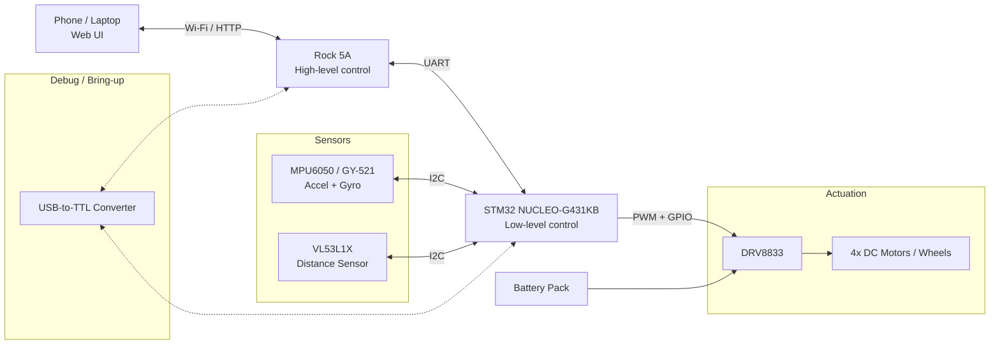

# Rock5A + STM32 Rover

A small 4-wheel robotic rover steered by a STM32 MCU (Nucleo G431KB) and a Rock5A 8GB.

## Architecture

The Rock 5A acts as the high-level computer, while the STM32 handles low-level hardware control.

The goal is to gradually extend the system with sensors, feedback, and eventually higher-level autonomous behavior.

## Hardware

- **Rock 5A (8 GB)**: Linux (Ubuntu) SBC for high-level control [link](https://docs.radxa.com/en/rock5/rock5a/getting-started/introduction)
- **STM32 NUCLEO-G431KB**: microcontroller for real-time motor control [link](https://www.st.com/en/evaluation-tools/nucleo-g431kb.html#documentation) 
- **4-wheel robot chassis**: 4 DC geared motors, wheels, mounting plates [link](https://amzn.eu/d/0azrdLgF)
- **DRV8833**:  dual H-bridge motor driver [link](https://amzn.eu/d/0gSeg3x7)
- **L298N**:  alternative motor drivers (as a backup) [link](https://amzn.eu/d/02MSqJXz)
- **MPU6050** (GY-521):  accelerometer + gyroscope [link](https://amzn.eu/d/01muZGfY)
- **VL53L1X**:  laser distance sensor for obstacle detection [link](https://amzn.eu/d/02bBO0LR)
- **USB to TTL Serial Module**:  UART to USB converter [link](https://amzn.eu/d/01C2FUlQ)

## Milestones

- [x] Set up Rock 5A with Linux and remote development
- [x] Set up STM32 firmware and UART communication
- [x] Establish UART communication between Rock 5A and STM32
- [x] Implement a C++ serial port abstraction on Rock 5A
- [ ] Generate PWM signals with STM32 timers
- [ ] Control one DC motor through DRV8833
- [ ] Control all four wheels (forward, reverse, turning)
- [ ] Send motor commands from Rock 5A over UART
- [ ] Add sensors and feedback
- [ ] Implement basic autonomous behavior