Amazon link: https://amzn.eu/d/06AYvV6F

### What voltage does it need?

Schematic form amazon shows a circuit which takes in 5V and translates it to the 2.xV - 3.xV necessary for the MPU chip

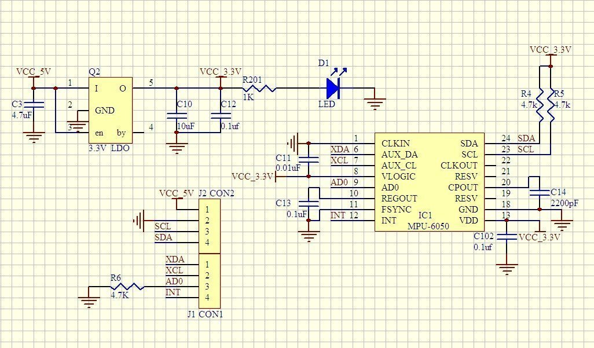

### Communication specs and slave address

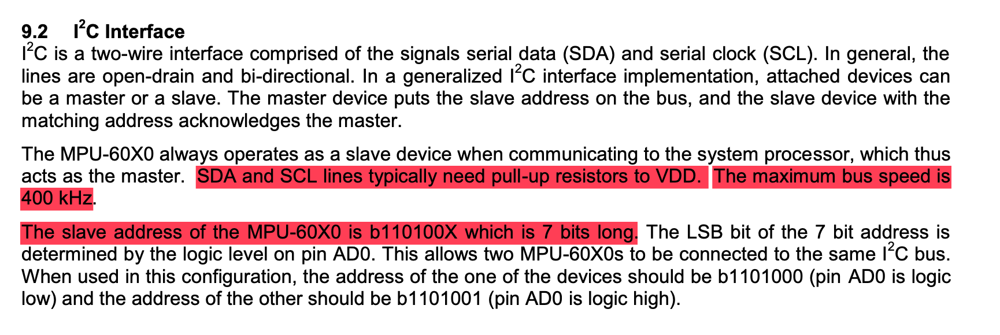

Comms with all registers is I2C at (up to) 400 kHz.

We will use 100 kHz first because I am not sure what the other I2C sensors support, and all will share the same bus.

Datasheet section 9.2:

0b110100X whee X is the AD0 value (the pin which allows to change the slave address id we need to). By default AD0 is logic low (0), 
so we have

0b1101000 --> 0x68

The STMs HAL_I2C_Mem_Read function expects the slave address to be shifted to the left by one, see STM32 HAL reference. So:

0b1101000 << 1 --> 0b11010000 --> 0xD0

We can check if we cann connecto to the sensor by checking the WHO_AM_I register, it should answer with the MPU's the upper 6 bits of the 7-bit slave address:

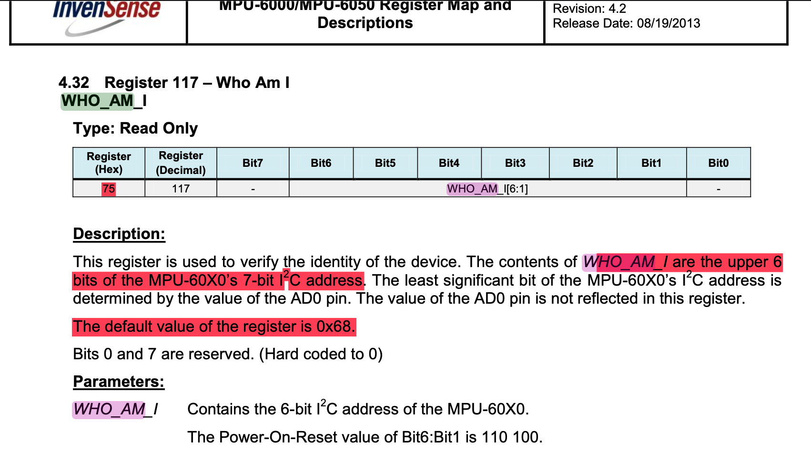
 

### Config

The device starts in sleep mode (see Register Map doc Section 4):

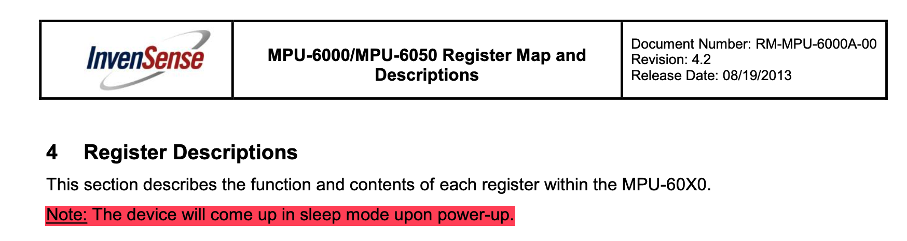

We need to wake it up. The SLEEP mode is toggled via the <code>PWR_MGMT_1</code> register

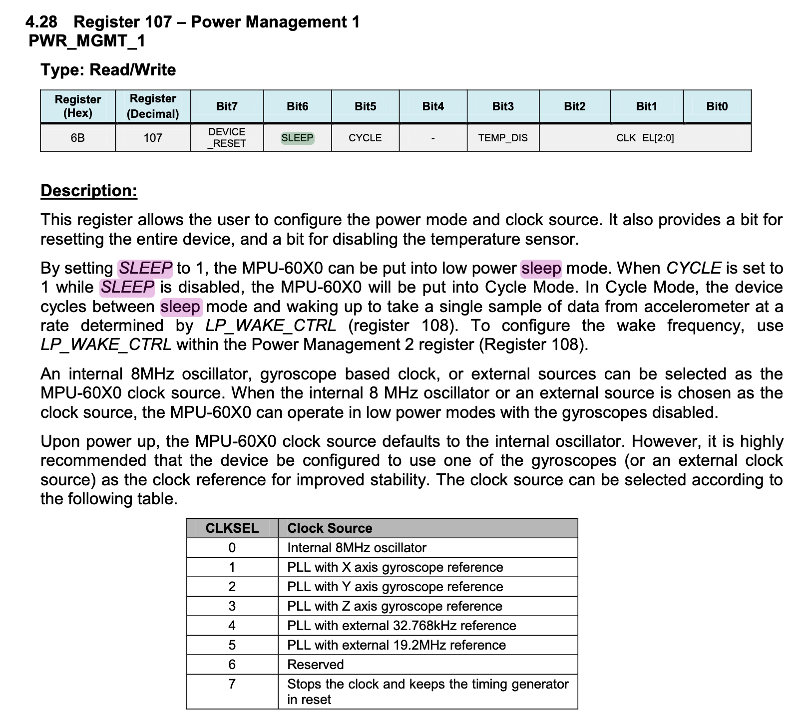

The accelerometer and gyroscope ranges can be configured with the ACCEL_CONFIG (0x1C) and GYRO_CONFIG (0x1B) registers, respectively. I am setting both to 0 which sets the accelerometer range to +/- 2g and gyroscope range to 250 degrees/s (the smaller the value, the higher the sensitivity).

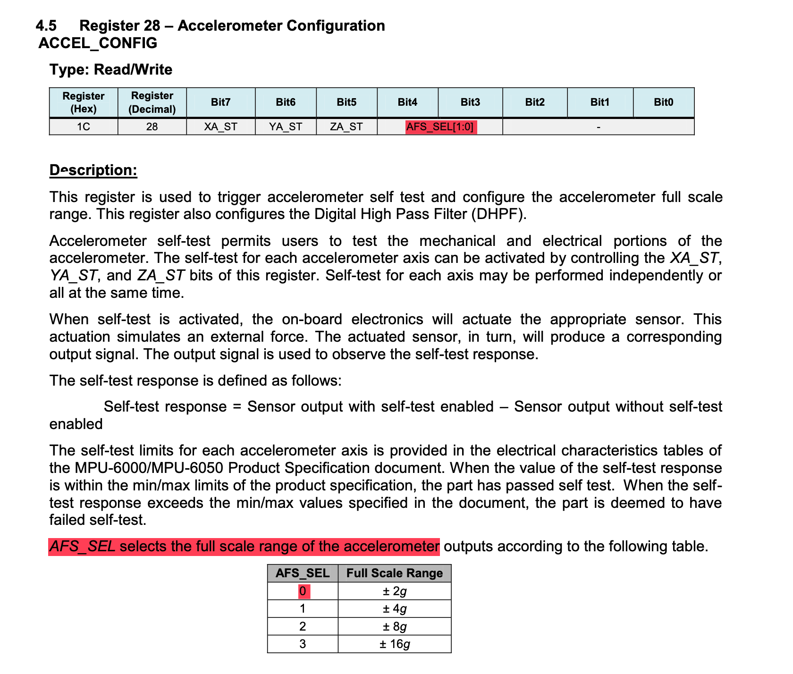

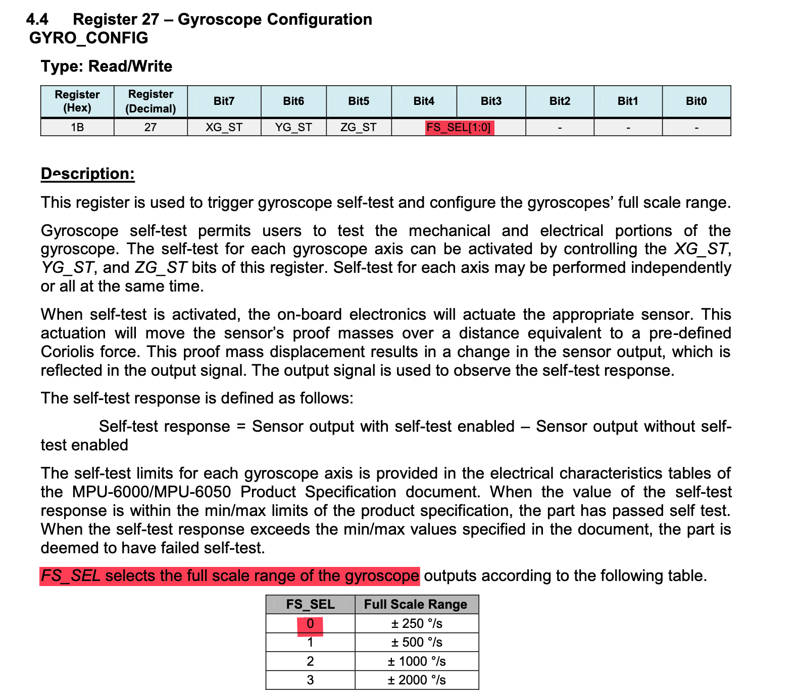

### Reading out the values

We can read out the values by burst reading (consecutive reading of registers). The registers for the accelerometer, temperature and gyroscope are all stored consecutively in a total of 14 bytes. All raw values are stores as 2's complement 16 bits. Because each register just holds 8 bits, each value needs to be merged (bitwise OR) out of two consecutive registers (_H suffix for higher bits, _L suffix for lower bits)

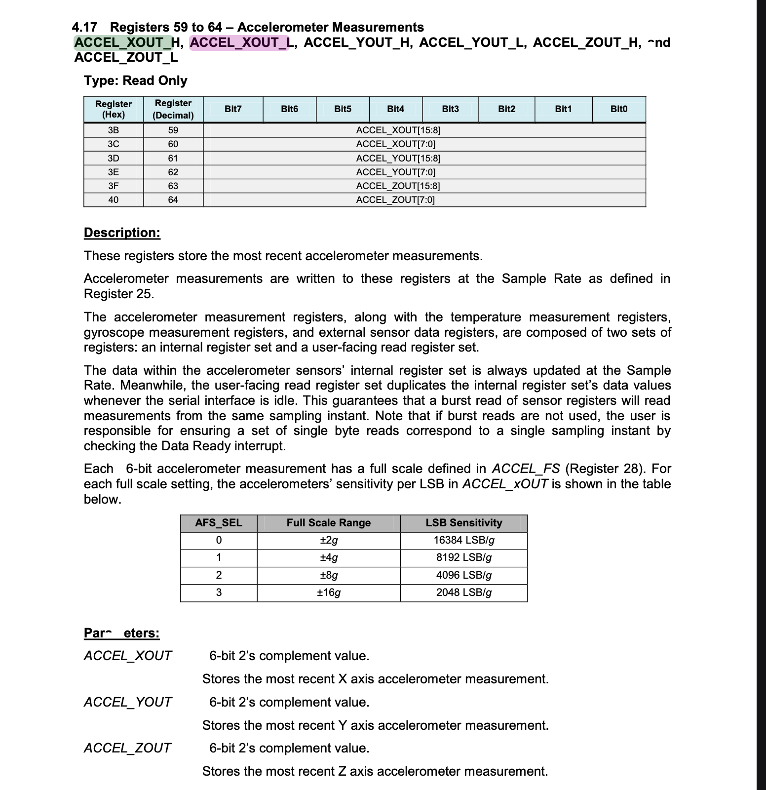
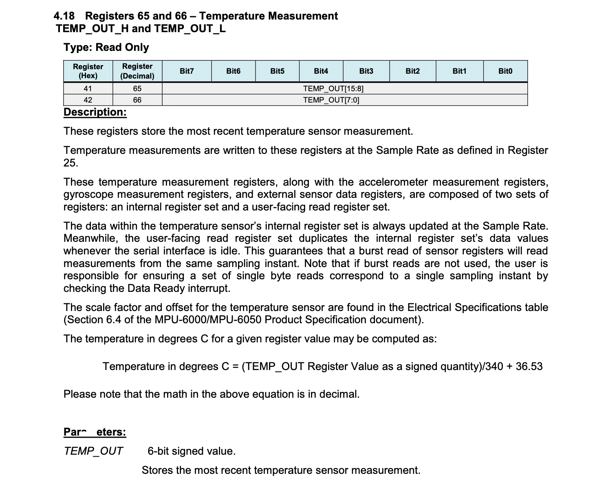
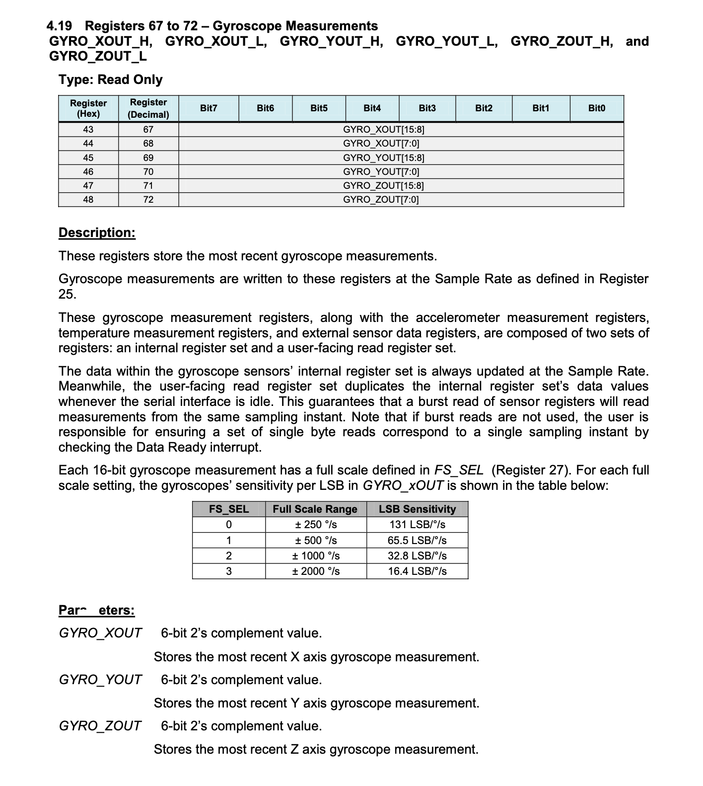

# Transormation of values according to range

The registers hold raw values. To translate them into their respective units we need to map them based on selected range on the interval of all possible raw values, so an interval from MIN_int16_t to MAX_int16_t. Since all values are 16-bit signed ints (2's complement), the MIN and MAX values are:

MIN: -32768 (b1000 0000 0000 0000)
MAX: 32767 (b0111 1111 1111 1111)

They are asymmetric, because in 2's complement one of the "positive" possibilities goes to represent the number 0 (0000 0000 0000 0000)

For Accelerometer:

-2g = -32768
+2g = 32767

1g = 32767 / 2 = 13383,5 ~ 13384

So to display the value in register_xyz, we need to:

register_xyz / 13384f = display_value_xyz

Similar for gyroscope:

250 deg = 32768
1 deg = 131,068f

For the temperature, we get the equation from the documentation above:

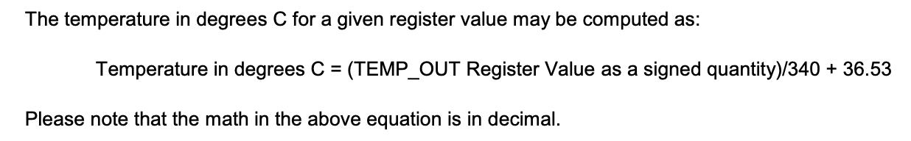

